# Software Factory: Autonomy Gap Analysis

Review date: 2026-10-01. Scope: whole repo at commit `42f07df`. Read-only review; evidence is cited by file path.
Local checks run: `tsc --noEmit` passes; `jest` = 55 pass / 6 fail (61 tests).

## 1. Verdict

**Partial. Not able to run autonomously start-to-finish today, for CREATE or CHANGE.**

- A TypeScript orchestrator exists (`.factory/`) with state, retry-on-transient-error, snapshots, notifications, metrics, and a GitHub-issue trigger. That is more than `.claude/CLAUDE.md` describes (CLAUDE.md presents a prompt-only workflow).
- But the orchestrator and the agent library describe **different workflows**. Against the real agent files, phases 3 to 5 can never succeed, and nothing writes generated code to a repo.
- The "graph" is hard-coded imperative TypeScript. There are no schemas, no loop-back, no brownfield mode, and no real quality gate that executes tests.

## 2. Inventory: exists vs. claimed

| Area | Exists | Claimed but missing / inconsistent |
|---|---|---|
| Agents (`.claude/agents/`, 15 files) | product-manager, analyzer, mcp-configurator, software-architect, platform-architect, ui-designer, backend-engineer, frontend-engineer, infrastructure-engineer, automation-tester, e2e-tester, customer-support, reviewer, **builder** (generic), **skeptical-reviewer** | `FILE_MANIFEST.txt` lists `architect.md` (absent). CLAUDE.md "12 agents" vs 15 files vs 13 in `orchestrator.ts:validateSetup`. `skeptical-reviewer` and `builder` are in no flow; TODO.md lists skeptical-reviewer as "future". |
| Skills (`.claude/skills/`, 6 files) | backend-patterns, documentation-patterns, mcp-setup, testing-patterns, testing-suite, ui-design-system | `frontend-patterns.md` and `infra-patterns.md` (CLAUDE.md, README) are missing. `testing-suite` is undocumented. |
| Orchestrator (`.factory/*.ts`, ~2k LOC) | orchestrator, state, claude-bridge, cli, run-workflow, github-integration, notifications, rollback, recovery, cleanup, logger, metrics, analytics, 3 test suites | CLAUDE.md never mentions it. README says `npm run factory:run`, `factory:kill`, `validate:setup`, `validate:config`, `factory:help`; none exist in `package.json`. |
| Workflows (`.github/workflows/`) | factory-start (issue label `ready-to-build`), factory-test, factory-deploy | factory-deploy deploys the *orchestrator itself* (echo only). No workflow runs `claude`. |
| Config | `project.config.json` (example SaaS), `.branchspec.json.example`, `.claude/settings.json` | No JSON Schema for either config (`$schema` in branchspec points to `example.com`). `settings.json` has `model: claude-sonnet-4-20250514`, MCP servers `enabled:false`, no permissions block. |
| Scripts | setup-mcp.sh, validate-mcp.sh, validate-setup.sh, validate-branchspec.sh, credentials.sh.template | `validate-branchspec.sh` only prints values; nothing enforces them. |
| Docs | README, QUICKSTART, TODO, CONTRIBUTING, docs/{ORCHESTRATION,IMPLEMENTATION,CONFIGURATION,BRANCH-SPEC,mcp-setup-guide}.md | CONTRIBUTING and CLAUDE.md require `develop`; **no `develop` branch exists** (only `main`). `TODO.md` has stale checkboxes (items shown unchecked already exist: github-integration, validate-setup, tests, deploy.yml). |

## 3. Stated objectives (from README, CLAUDE.md, ORCHESTRATION.md)

1. "Graph-engineered multi-agent workflow: project brief to production-ready code with zero manual intervention" (README L3).
2. 12-agent pipeline with `valid` gates; parallel builders and testers "zero token cost" (README, CLAUDE.md).
3. State persistence, retry from any point, MCP auto-wiring.
4. Issue label `ready-to-build` starts a run; companion PR tracks progress; reviewer is the QA gate; failure loops back to builders (CLAUDE.md L142, L153; ORCHESTRATION.md L338).
5. Git Flow plus `.branchspec.json` controlling auto-merge and approvals.
6. README admits that Actions autonomy is "not yet supported" (10 listed blockers).

## 4. Scorecard

| # | Dimension | Score | Evidence |
|---|---|---|---|
| a | Workflow graph as data | **Missing** | Only ASCII in CLAUDE.md / ORCHESTRATION.md. `orchestrator.ts:519-777` is ~260 lines of copy-pasted if/else sequential code. `Phase` union is hard-coded in `state.ts:4`. No node/edge file, conditional edges, loop-back, max iterations or termination conditions. `test-workflow.json` is a test fixture (stage list, no edges). |
| b | Executable orchestrator | **Partial** | `cli.ts start/status/list/watch/retry`, `run-workflow.ts` (env: `ISSUE_TITLE`). Trigger: `factory-start.yml` on issue label only (the issue *body* is ignored, only the title is the brief). No cron, webhook, PR-comment or `workflow_dispatch` trigger. Runner needs `claude` CLI and API key; the workflow installs neither and passes no secret. Agent call is `execSync('claude')` with stdin and no `-p`, `--output-format`, `--allowedTools` or `--permission-mode` (`claude-bridge.ts:119`), and a **30 s** default timeout vs 2-12 min phases. |
| c | Contracts | **Partial** | Each agent has a prose "Output Format" JSON example with `phase`, `valid`, `next_inputs`, `blockers`. No JSON Schema files, no ajv. `validateAgentResponse` (`orchestrator.ts:56`) checks only phase/valid/error/artifacts shape. `blockers`, `next_inputs` and `generated_files` are never read. No contract versioning. |
| d | State & persistence | **Partial** | `state.ts` writes `workflows/<id>.json` (docs say `.factory/workflows/`), run IDs present, snapshots in `rollback.ts`. `cmdRetry` builds a trimmed state, saves it, then calls `executeWorkflow`, which **creates a fresh workflow from phase 1** (`orchestrator.ts:490`), so resume does not work. `recoverState()` on every start flips unrelated running workflows to running and re-writes them. Artifacts are inline JSON in the state file (no artifact store). No idempotency keys, no lock. State is gitignored and local; on an Actions runner it is lost. |
| e | Create vs Change modes | **Missing** | Greenfield only. No repo-ingestion, codebase-map, impact-analysis, patch/diff output, migration-safety, or issue-to-change-request agent. "brownfield" appears nowhere. Agent outputs are green-field file lists (`generated_files`), not diffs. |
| f | Failure handling | **Partial** | Exponential backoff only for errors whose message contains timeout/econn/enotfound/network (`orchestrator.ts:151`), and only for sequential phases (parallel has none). No loop-back despite claims: reviewer `valid:false` sets `status=failed` and returns (`:732-749`). No max-iteration, token/cost budget, wall-clock budget, deadlock guard, or escalation state (`status` = running/paused/completed/failed; no `escalated`). |
| g | Quality gates | **Missing** (as executed) | No sandbox step runs build/test/lint/typecheck/SAST on generated code. Reviewer and testers are LLM agents whose example output contains pre-filled passing numbers ("45 passed", "78%", "45ms avg", `approved_for_deployment: true`), so unverified self-reports can pass the gate. `npm audit`, secret scanning appear only as prose in `reviewer.md:251+`. No requirement-to-test traceability (PM acceptance criteria ids are not carried to tests). Factory's own CI is real (`factory-test.yml`) but covers only `.factory/`. |
| h | Delivery | **Partial / Missing** | `github-integration.ts` creates a PR from `factory/<id>` that is never created or pushed (call fails and is swallowed); base is `main`, not `develop`. Orchestrator never commits generated code. It squash-merges on success **ignoring `.branchspec.json`** (`orchestrator.ts:810`), contradicting CLAUDE.md step 7. No deploy to staging/prod, rollback (only `git checkout <sha>; git clean -fd` of the factory repo itself, destructive), env provisioning, DB migration run, or secrets store (env vars only). |
| i | Missing roles | **Missing** | No router/orchestrator agent, security engineer, DB/data engineer, release/SRE, change-impact analyst, bug-triage/maintainer, memory/knowledge, cost governor, or requirements-clarifier (human question channel). |
| j | Observability & evals | **Partial** | `logger.ts` (JSON logs to `logs/`), `metrics.ts`, `analytics.ts` track duration and status. No tokens/cost, no per-agent traces, no run report. No golden briefs, agent evals, or contract tests against real agent output; the 6 failing tests show the harness drifted from the code. |
| k | HITL & governance | **Partial** | `.branchspec.json.example` and `docs/BRANCH-SPEC.md` define policy, but it is not read by code. Slack/GitHub status notifications exist. No approval-gate node type, no per-agent tool allow-list (`settings.json` allows execute for npx/npm/node/python3/docker/git globally), no audit trail beyond `notes[]`. |
| l | Consistency | **Missing** | See section 5. |

## 5. Consistency findings (blocking)

| Finding | Evidence |
|---|---|
| Orchestrator phase names do not map to agent files. It invokes `architect`, `backend-builder`, `frontend-builder`, `infrastructure-builder`, `backend-tester`, `frontend-tester`, `infrastructure-tester`; the files are `software-architect`, `backend-engineer`, `frontend-engineer`, `infrastructure-engineer`, `automation-tester`. `readAgentMarkdown` throws, so every phase from 3 on returns `valid:false`. | `orchestrator.ts:576-665`, `state.ts:4-18`, `claude-bridge.ts:23-40`, `.claude/agents/` |
| `validateAgentResponse(response, agentName)` requires `response.phase === agentName`, yet agent files emit `"phase": "software-architect"`, `"backend-engineer"` etc., so even a correct agent fails the gate. | `orchestrator.ts:290`, `.claude/agents/*.md` "phase" |
| Pipeline in code skips mcp-configurator, platform-architect, ui-designer and automation-tester, and runs customer-support *after* reviewer. CLAUDE.md puts support in the parallel builder set and the reviewer last. | `orchestrator.ts:519-777` vs `.claude/CLAUDE.md` diagram |
| Handoffs: each phase gets only the *latest* artifact (`getLatestArtifact`). Architect never receives PM requirements or MCP tools; testers/E2E get no acceptance criteria. Agents' `next_inputs` keys (`ready_for_architect`, `mcp_servers_to_configure`...) are never consumed. Agent `Input` sections list different sources than the orchestrator supplies. | `orchestrator.ts:552,580,608`; agents' `## Input` |
| Agents emit file *descriptions* (path, lines, description), not file contents, and do not say to write to disk; "commit via GitHub MCP" depends on MCP servers that are `enabled:false` and unwired in CI. | `backend-engineer.md:59+`, `settings.json` |
| "Zero token cost" parallelism: `Promise.all` orchestration is free, but each parallel agent call costs tokens; claim appears in README x4, ORCHESTRATION.md:295. | `orchestrator.ts:398` |
| 6 jest failures (`orchestrator.test.ts`, `integration.test.ts`) from the same phase-mismatch validation (mock returns previous phase). CI would be red. | `npx jest` |
| `develop` branch absent; PR base `main` in code and workflow; CLAUDE.md says target `develop`. | `git branch -r`, `github-integration.ts:35`, `factory-start.yml` |
| Docs reference non-existent npm scripts and file paths (see section 2). | README, QUICKSTART |

## 6. Prioritized gap list

### P0: blocks autonomy

| # | Gap | Why it matters | Add (path + spec) |
|---|---|---|---|
| P0-1 | Orchestrator and agent library disagree (names, phase ids, 13/12/15 agents, order) | Real run dies at phase 3; gate rejects correct output | Single source of truth `factory/graph.yaml` (see P0-2). Rename agents or map `node.agent -> .claude/agents/<file>.md`. Fix tests; add a CI test asserting every graph node resolves to an agent file and every agent emits `phase == node.id`. |
| P0-2 | No graph-as-data | Cannot add roles, loop-backs, modes, or reason about termination | `factory/graph.yaml` + `factory/graph.schema.json`. Node: `{id, agent, type: agent\|parallel\|gate\|human\|exec, inputs:[artifact ids], outputs:[artifact id], retries, timeout_s, budget_usd}`. Edge: `{from, to, when: <expr on output>, kind: next\|retry\|loopback\|escalate, max_iter}`. Graph-level: `entry`, `terminals: SUCCESS\|ESCALATED\|FAILED`, `max_total_iterations`, `max_cost_usd`, `wall_clock_s`. Replace `executeWorkflow` body with a generic graph runner `.factory/engine.ts` (topological scheduling, fan-out/fan-in barriers). |
| P0-3 | No JSON Schema contracts | LLM output cannot be trusted or routed (`blockers`, `next_inputs` ignored) | `contracts/<agent>.input.schema.json` / `.output.schema.json` + `contracts/envelope.schema.json` (`phase, valid, error, artifacts[], blockers[], metrics{tokens,usd}, schema_version`). Validate with ajv in the engine; on failure send a repair prompt with the ajv errors (max 2). |
| P0-4 | Agents can't produce real code in a real workspace | Output is JSON prose, nothing lands in git | Run builders as `claude -p --output-format json --allowedTools ... --permission-mode acceptEdits` in a per-run git worktree (`.factory/workspace.ts`: clone/checkout `factory/<run>` from `develop`, commit per node, push). Agents return a *manifest* (files changed, commands run), the engine verifies the manifest against `git diff`. |
| P0-5 | No executed quality gate | LLM self-reports pass a fake QA gate | `.factory/gates/exec-gate.ts` (node type `exec`): in sandbox/container run install, `tsc`/lint, unit+integration tests, coverage threshold from `project.config.json.testing`, `npm audit`/`osv-scanner`, secret scan (`gitleaks`), SAST (`semgrep`), Playwright for E2E. Output `gate-report.json` is the only input the reviewer may cite. Reviewer rubric `contracts/reviewer.rubric.json`. |
| P0-6 | Failure loops absent | A single `valid:false` kills the run; infinite loops would be unguarded once added | Engine: loop-back edges carry `feedback` (blockers + gate report) to the builder, `max_iter` per edge, global budget; terminal `ESCALATED` opens an issue/PR comment with run summary and halts. Add `escalated`/`paused_for_human` to run status. |
| P0-7 | No CHANGE mode | "create and change" is half the goal | `mode: create\|change` in run input. Add agents `repo-ingestor` (clone, build repo map, stack detect, test baseline), `change-analyst` (issue/PR -> change request, impact analysis, affected files, migration/back-compat risks, test plan), `maintainer-triage`. Builders get `patch` mode (minimal diff, existing conventions, regression tests first). Add trigger for labels `change-request`, `bug`. |
| P0-8 | Trigger/runner can't run in CI | Cannot start unattended | `factory-start.yml`: install claude CLI, `ANTHROPIC_API_KEY` secret, pass issue body (not only title), `concurrency: factory-${{issue}}`, checkout `develop`, push branch before PR, upload `workflows/` + `logs/` as artifacts, resume via `workflow_dispatch {run_id}`. Alternative: use the Claude Agent SDK in `.factory/claude-bridge.ts` (replaces `execSync('claude')`). |
| P0-9 | Delivery ignores policy; auto-merges | Violates CLAUDE.md rules and branch spec | `.factory/policy.ts` reads `.branchspec.json` (schema-validated), enforces `auto_merge`, `allow_agent_approval`, required checks, protected paths; merge only via `gh pr merge --auto` after required checks. Fix base branch to `develop`; create `develop`. |

### P1: reliability

| # | Gap | Add |
|---|---|---|
| P1-1 | Resume/checkpoint broken | Engine persists per-node `status, attempt, input_hash, output_ref`; `factory resume <run_id>` skips nodes with same `input_hash`; file lock `runs/<id>/.lock`; remove `recoverState` side effects. |
| P1-2 | Artifact store | `runs/<id>/artifacts/<node>/<n>.json` + `manifest.json` (content hash); state holds refs, not blobs. Required by P0-3 inputs and by CI upload. |
| P1-3 | Requirement traceability | PM emits `AC-###` ids; testers tag tests `@AC-###`; `traceability.json` generated by exec gate; reviewer fails if any must-have AC lacks a passing test. |
| P1-4 | Cost/latency governor | `metrics.tokens/usd` in envelope; engine enforces `budget_usd` per node and run; model-per-node in graph (cheaper model for docs/support). |
| P1-5 | Roles: security-engineer, db-engineer (migrations, rollback scripts, run against ephemeral Postgres), release-engineer/SRE (deploy, smoke test, rollback), requirements-clarifier (blocks with a question issue comment instead of failing), router. | `.claude/agents/<role>.md` + nodes in graph. |
| P1-6 | Deployment | `deploy` exec node (staging then prod behind human gate), health check, auto-rollback, env provisioning from `platform-architect` output (IaC apply in sandbox), secrets via GitHub Environments/vault, not `credentials.sh`. Replace the echo-only `factory-deploy.yml`. |
| P1-7 | Least privilege | Per-node `allowedTools`, fs scope (worktree only), network allow-list, no shared long-lived tokens; MCP servers enabled per node only when creds validated. Remove global `allow_execute` for `docker`/`git` on analysis agents. |
| P1-8 | Fix harness | Green the 6 failing tests; add CI job asserting docs/scripts/files referenced exist (`scripts/check-doc-refs.sh`); clean TODO.md; delete or wire `builder.md` and `skeptical-reviewer.md`. |
| P1-9 | Retry policy | Retry also for malformed JSON, rate limits, and in parallel nodes; jitter; per-node timeout (raise from 30 s). |

### P2: nice to have

| # | Gap | Add |
|---|---|---|
| P2-1 | Evals | `evals/briefs/*.json` (3 greenfield, 3 change) with expected-gate assertions; nightly `factory-eval.yml` running the graph with a cheap model; record pass-rate/cost trend. |
| P2-2 | Memory/knowledge agent | `memory/` (decisions, conventions, past failures) summarized into each node's prompt; updated post-run. |
| P2-3 | Run report | `runs/<id>/REPORT.md` and a Mermaid/HTML timeline; PR description auto-filled. |
| P2-4 | Dashboard, templates, conditional skip of nodes by `project.config.json` | Graph `when:` on nodes (e.g. skip `ui-designer` for API-only). |
| P2-5 | Config schemas | `schemas/project.config.schema.json`, `schemas/branchspec.schema.json`, validated in `validate-setup.sh` and the engine. |
| P2-6 | Compliance agent (GDPR/SOC2/licenses), already in TODO. | |

## 7. Target graph (CREATE and CHANGE)

```mermaid
flowchart TD
  T[/"Triggers: issue label ready-to-build / change-request / bug / cron / dispatch / PR comment"/] --> R[router: classify mode, load config + branchspec, create run_id, lock, budget]
  R --> PV{preflight exec: creds, MCP, schemas, claude auth}
  PV -- fail --> ESC
  PV -- ok --> M{mode}

  M -- create --> PM[product-manager]
  PM --> CLQ{blockers / ambiguity?}
  CLQ -- yes --> HQ[/human gate: clarifying question on issue/] --> PM
  CLQ -- no --> AN[analyzer]

  M -- change --> RI[repo-ingestor: clone, repo map, baseline tests]
  RI --> CA[change-analyst: change request, impact analysis, test plan, migration risk]
  CA --> RISK{high risk / breaking / prod data?}
  RISK -- yes --> HG1[/human gate: approve plan/]
  RISK -- no --> MC
  HG1 --> MC

  AN --> MC[mcp-configurator + secrets check]
  MC --> ARCH
  subgraph ARCH [fan-out: architecture]
    SA[software-architect]
    PA[platform-architect]
    DB[db-engineer: schema + migrations plan]
    SEC[security-engineer: threat model]
  end
  ARCH --> UI[ui-designer, skipped if API-only]
  UI --> BUILD
  CA --> BUILD
  subgraph BUILD [fan-out: builders in git worktree, create=generate / change=patch]
    BE[backend-engineer]
    FE[frontend-engineer]
    IE[infrastructure-engineer]
    AT[automation-tester]
    CS[customer-support: docs]
  end
  BUILD --> JOIN{{fan-in barrier: all valid}}
  JOIN -- any invalid --> LB1[loop-back with feedback, max_iter 3]
  LB1 --> BUILD
  JOIN --> GATE[exec gate in sandbox: build, lint, typecheck, unit/integration, coverage, migrations on ephemeral DB, SAST, secrets, dep audit, AC traceability]
  GATE -- fail --> LB2[loop-back to owning builder with gate report, max_iter 3]
  LB2 --> BUILD
  GATE --> E2E[e2e-tester: Playwright on ephemeral env]
  E2E -- fail --> LB2
  E2E --> REV[reviewer + skeptical-reviewer: rubric over gate-report.json]
  REV -- reject --> LB2
  REV --> POL{policy: branchspec, protected paths, risk}
  POL -- needs human --> HG2[/human gate: PR approval/]
  POL -- auto --> PR
  HG2 --> PR[push branch, open PR to develop, required checks]
  PR --> MERGE[merge when checks + approvals satisfied]
  MERGE --> DEP[release-engineer: deploy staging, smoke, then prod via human gate, DB migrate]
  DEP -- fail --> RB[auto-rollback] --> ESC
  DEP --> OK((SUCCESS))

  GOV[[cost governor + max_iter + wall clock]] -. trips .-> ESC
  LB1 & LB2 -. iteration cap .-> ESC
  ESC((ESCALATED: issue comment + run report, resumable))
  FAIL((FAILED: unrecoverable infra/contract error))
  PV -. fatal .-> FAIL
  MEM[(memory + artifact store + run log + eval metrics)] -.- R
```

Where missing pieces plug in: `router`, `repo-ingestor`, `change-analyst`, `db-engineer`, `security-engineer`, `release-engineer` are new agents; `exec gate`, `policy`, `preflight`, `cost governor` are engine node types (code, not LLM); loop-back edges and terminals come from `factory/graph.yaml`.

## 8. Roadmap (4 phases to a minimal autonomous run)

| Phase | Goal | Deliverables | Exit criterion |
|---|---|---|---|
| 1. Make it truthful | One consistent, green, local pipeline | Reconcile phase/agent names (P0-1); contracts + ajv (P0-3); fix `cmdRetry`/recovery; green tests; doc/script drift CI; create `develop`; real `claude -p` invocation with sane timeouts | `factory start` on a golden brief runs PM to reviewer on a laptop with real agents and valid envelopes |
| 2. Graph engine + real artifacts | Graph as data; code lands in git | `graph.yaml` + engine (P0-2), worktree workspace and commits (P0-4), artifact store and checkpoints (P1-1/1-2), loop-back + iteration/cost caps + `ESCALATED` (P0-6, P1-4) | Greenfield brief produces a pushed branch with a PR to `develop`; killed run resumes |
| 3. Real gates + CI autonomy | Unattended from issue to PR | Exec gate (P0-5), traceability (P1-3), CI runner with secrets and concurrency (P0-8), branchspec policy enforcement (P0-9), per-node permissions (P1-7) | Label an issue; PR appears with green required checks and gate report; no human until merge approval |
| 4. CHANGE mode + delivery | Maintain existing SaaS | repo-ingestor, change-analyst, patch-mode builders, bug/change triggers (P0-7); db-engineer, security-engineer, release-engineer, deploy/rollback (P1-5/1-6); eval suite (P2-1) | Change-request issue on an existing repo yields a minimal-diff PR with regression tests; staging deploy and rollback tested; nightly evals green |
